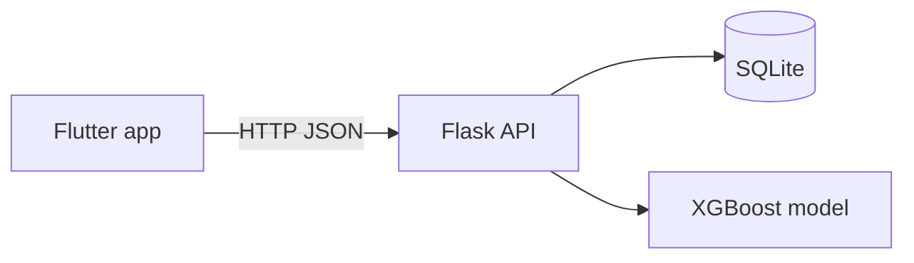

# PPD Care

A postpartum depression (PPD) risk screening system: a Flask backend that serves an XGBoost model, and a Flutter mobile app for check-ins, sleep tracking and family support.

    

> **Disclaimer:** PPD Care is a screening and support tool, not a medical diagnosis. If you or someone you know needs help, call Tele-MANAS **14416** or emergency services **112** (India).

## Features

- Mood check-in with a PPD risk prediction from a 28-feature XGBoost model
- Trusted contacts and family alerts
- Sleep logging
- Optional research consent, submission and withdrawal
- Admin page for reviewing and activating candidate model versions
- In-app support helpline links

## Tech stack

| Layer | Technology |
|-------|------------|
| Mobile app | Flutter / Dart |
| Backend | Python, Flask, Flask-CORS |
| Database | SQLite via SQLAlchemy (created on first run) |
| ML | XGBoost (decision threshold 0.29) |

## Architecture



## Project structure

```
ppd-care/
├── backend/
│   ├── app.py                  # Flask entry point and routes
│   ├── config.py               # paths, threshold, feature list
│   ├── database.py, models.py  # SQLAlchemy setup and tables
│   ├── model_loader.py, model_registry.py
│   ├── *_service.py            # prediction, check-in, sleep, contacts, alerts, research, profile
│   ├── backup_export.py        # data export utility
│   ├── templates/admin.html
│   └── models/ppd_xgboost_tuned_model.json
├── ppd_care_app/               # Flutter app
├── scripts/                    # model training script (dataset not included)
├── requirements.txt
└── LICENSE
```

## Run the backend

```bash
git clone https://github.com/sachuki4207l/ppd-care.git
cd ppd-care
python -m venv .venv
# Windows: .\.venv\Scripts\Activate     Linux/macOS: source .venv/bin/activate
pip install -r requirements.txt
python backend/app.py
```

The API starts on `http://127.0.0.1:5000`. The SQLite database is created automatically on first run. Check it with `GET /health`.

## Run the mobile app

```bash
cd ppd_care_app
flutter pub get
flutter run
```

In the app's **Settings** screen, enter your backend's host and port (use your computer's LAN IP, not `127.0.0.1`, when testing on a phone). To build an APK: `flutter build apk --release`. Prebuilt APKs are on the [Releases](https://github.com/sachuki4207l/ppd-care/releases) page.

## API

| Method | Route | Purpose |
|--------|-------|---------|
| GET | `/health` | Health check |
| POST | `/predict` | PPD risk prediction |
| POST | `/checkin` | Save a check-in |
| GET / POST | `/contacts` | List / add trusted contacts |
| DELETE | `/contacts/<id>` | Remove a contact |
| POST | `/alerts` | Send a family alert |
| GET / POST | `/sleep` | List / add sleep logs |
| POST | `/research/consent` | Give research consent |
| POST | `/research/submit` | Submit research data |
| POST | `/research/withdraw` | Withdraw consent |
| GET | `/admin` | Model review page |
| POST | `/admin/review`, `/admin/activate` | Review and activate model versions |

> The admin routes are meant for local or trusted use. Put authentication in front of them before exposing the server publicly.

## Database

Tables: `users`, `contacts`, `family_alerts`, `personal_checkins`, `sleep_logs`, `research_participants`, `research_submissions`, `model_versions`.

## Model

An XGBoost binary classifier on 28 survey features (education, income, family and relationship factors, pregnancy history, PHQ-2 depression screening and more), with a decision threshold of 0.29. The training script is in `scripts/`; the training dataset is not included. Add your dataset source and metrics here.

## Contributing

Fork the repo, create a feature branch, and open a pull request.

## License

MIT, see [LICENSE](LICENSE).